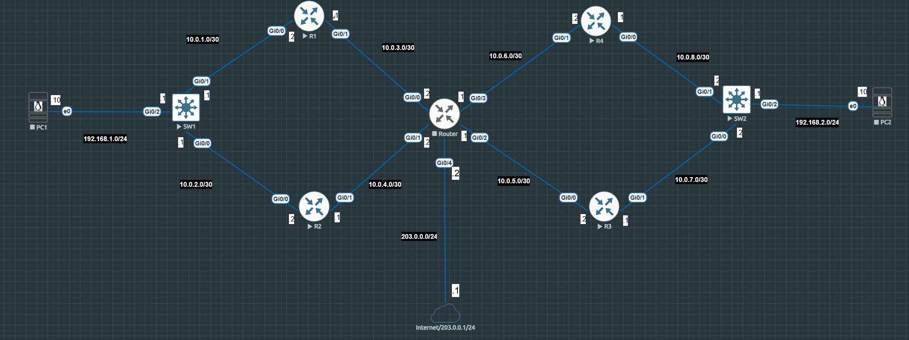
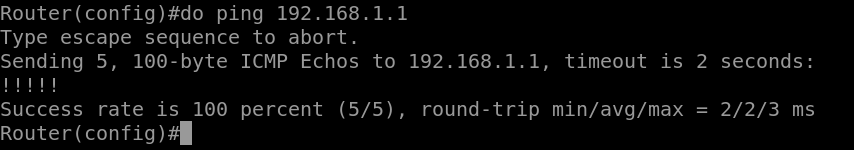
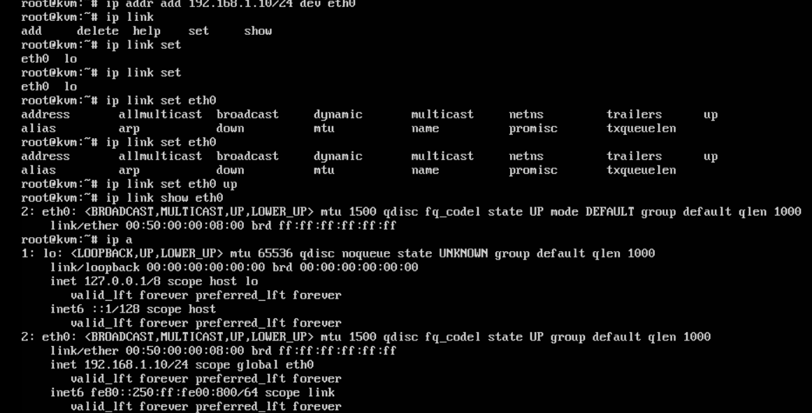

# Lab 01: Routing and Switching, Two-Site Network

## Scenario

Two customer sites (Site A on the left, Site B on the right) connected through a central router named ISP. Each site has redundant paths: two routers between the site's L3 switch and the ISP. The ISP also has an uplink to a simulated internet.

This is a simplified learning design. In a real provider network, the ISP would not carry customers' private addresses. See [Notes](#notes).

## Goals

1. Configure addressing on every link and verify connectivity hop by hop
2. Build static routing inside each site and understand why routes are needed in **both** directions
3. Observe ARP behaviour and verify with packet captures
4. Connect Site A and Site B with OSPF (see [Lab 03](../03-ospf-two-site/))

## Progress

- [x] Hostnames and interface IPs on all devices
- [x] Neighbour connectivity across the /30 links
- [x] Static routing within Site A (all devices can ping each other)
- [x] Static routing within Site B (all devices can ping each other)
- [ ] Site A to Site B connectivity (planned: OSPF)
- [ ] Default route, NAT, and internet edge on the ISP
- [ ] Failover testing (shut links, measure convergence)

## Devices

| Device | Role |
|--------|------|
| PC1, PC2 | Linux hosts (192.168.1.0/24 and 192.168.2.0/24) |
| SW1, SW2 | L3 switches (routed ports) |
| R1, R2 | Site A routers |
| R3, R4 | Site B routers |
| ISP | Central router (hostname to be renamed from `Router`) |

Full details are in [addressing-plan.md](addressing-plan.md).

## Verification

Example: the ISP router pinging SW1's LAN-facing interface after the static routes were in place.

PC1 addressing set from the Linux shell:

## What I learned

See [troubleshooting-notes.md](troubleshooting-notes.md) for the full write-ups. Key points so far:

- A ping needs a route in both directions. The request can arrive and still fail if the destination has no route back.
- ARP only resolves addresses on the directly connected link, so a device ARPs for the next hop, not for the final destination.

## Decisions and reflections

> TODO (in my own words): why /30 links, why routed ports on the switches, what I would do differently.

## Notes

- The ISP carries private (RFC 1918) routes here, which a real provider would not. A more realistic version would use eBGP between customer and provider with a tunnel between sites. Planned as a later extension.
